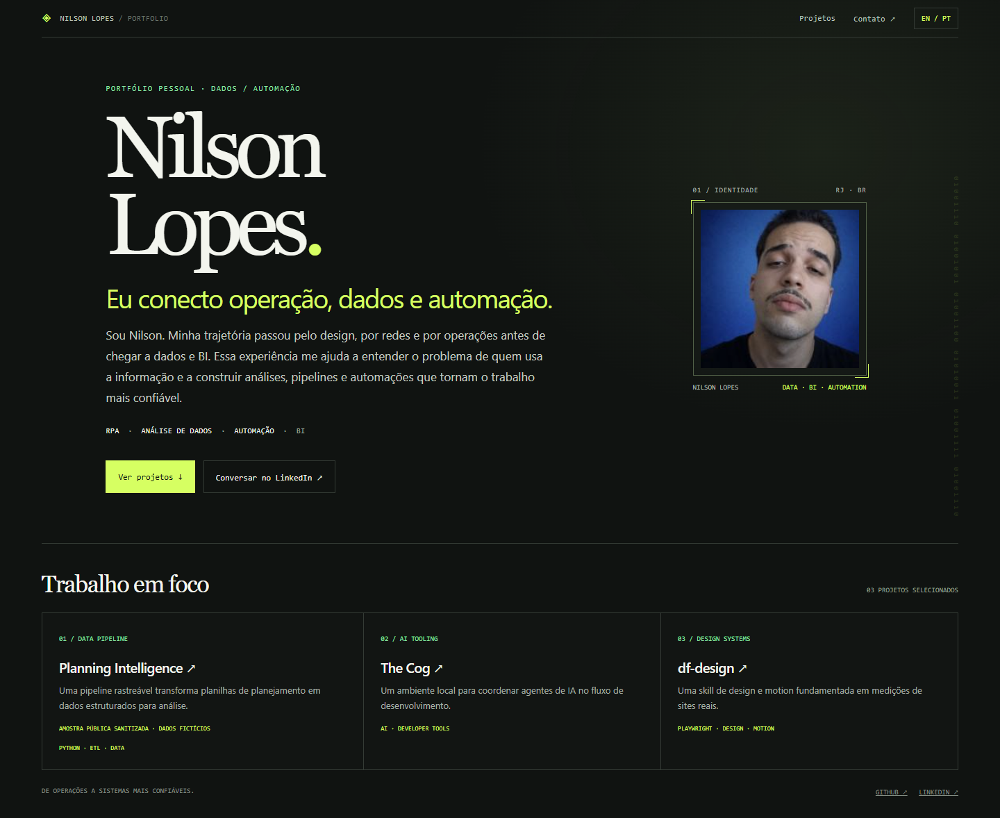
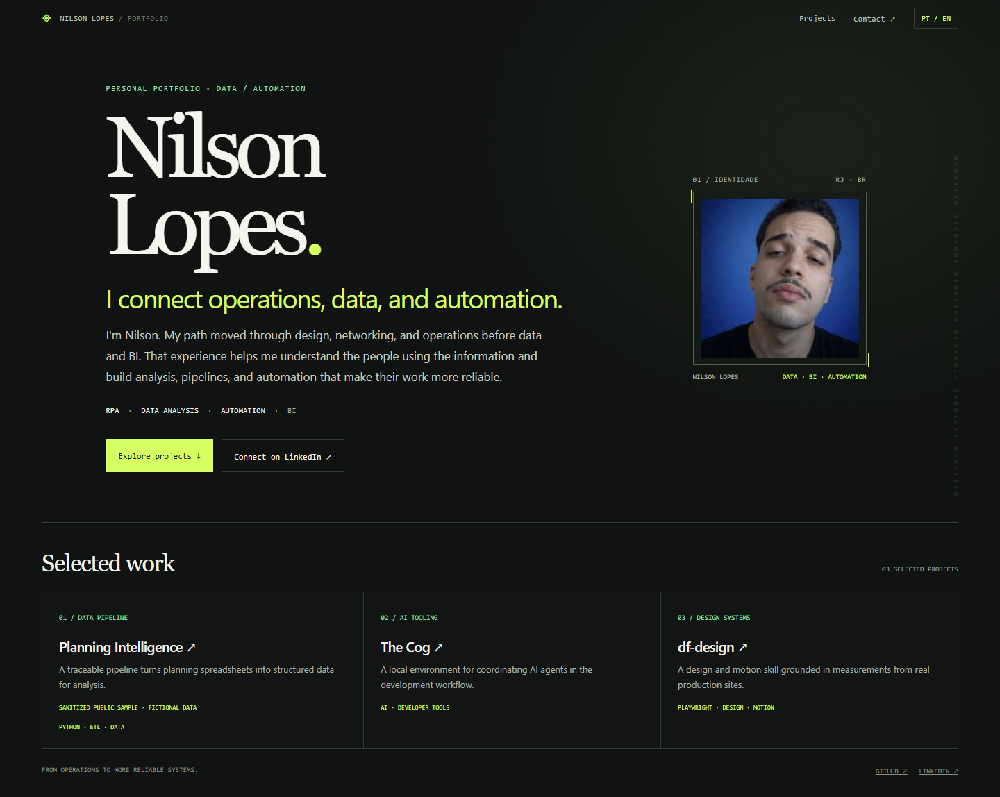
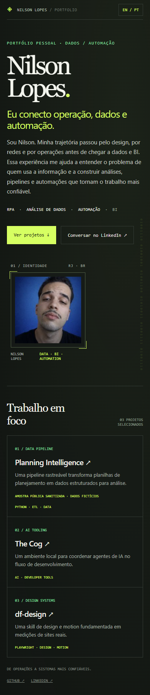

# Person-first portfolio preview

This is a visual concept preview for review, not the production site. It
explores the approved terminal/ASCII direction with a person-led introduction,
portrait, direct contact action, and linked project examples.

## Open it

Open `index.html` in a browser, or serve the repository root and visit
`/design/preview/`.

## Captures

- `captures/desktop-pt.png` — Portuguese, 1440px viewport
- `captures/desktop-en.png` — English, 1440px viewport
- `captures/mobile-pt.png` — Portuguese, 390px viewport

### Desktop, Portuguese

### Desktop, English

### Mobile, Portuguese

## Portrait

`github-avatar.jpg` is the 200 × 200 image currently used on Nilson's public
GitHub profile. It is included only to make the layout reviewable. Nilson should
provide a higher-resolution portrait or explicitly approve this image before
the final implementation uses it.
